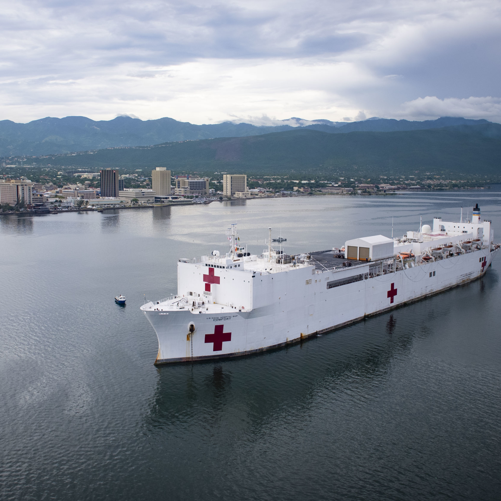
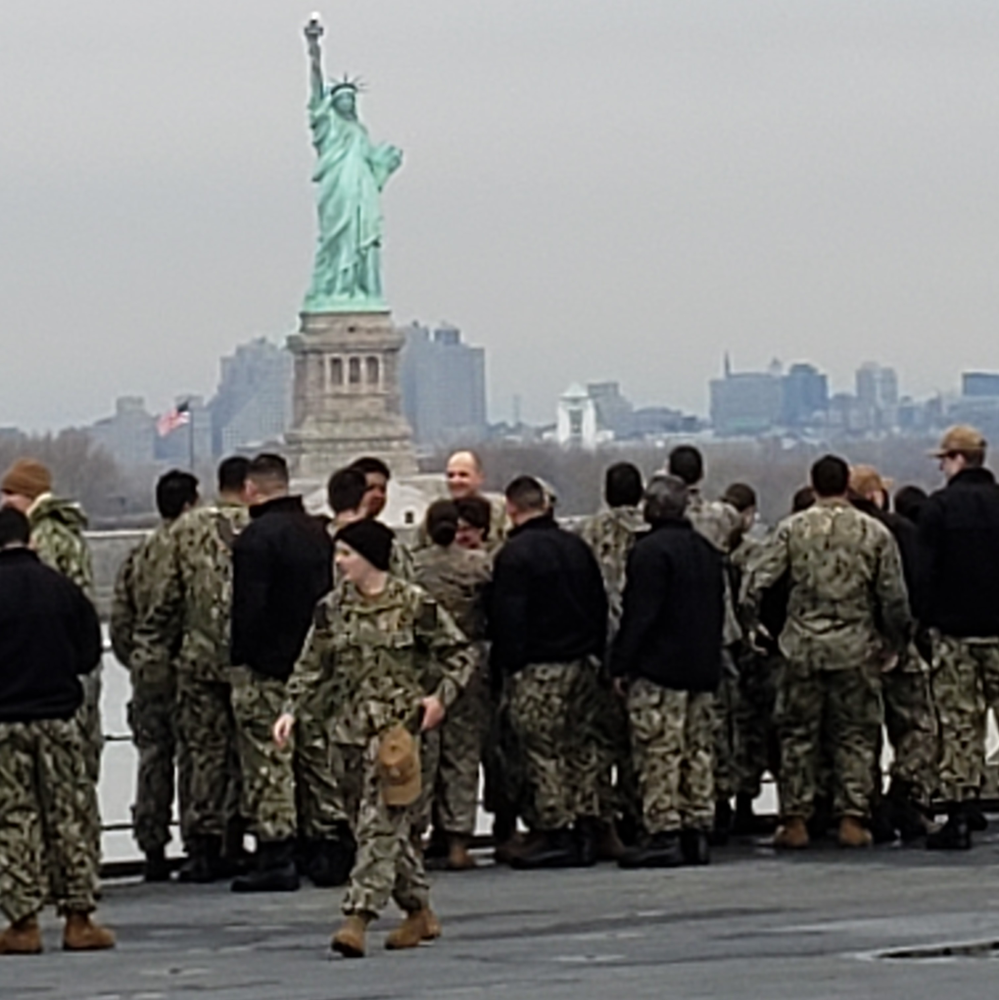

 

# Station at Naval Medical Center Portsmouth
I was stationed at NMRTC Portsmouth from December 2018 to January 2023 where I worked at the Oral Surgery Clinic as a Surgical Technologist. I earned the 
rank of Hospitalman Third Class and served as the Assistant Leading Petty Officer for the clinic for two years. I went on two deployments aboard the USNS Comfort, helped my Clinic to pass Joint Commission Inspection, and help my sailors move up in rank. I enjoyed going on humanitarian missions and this experience taught me guiding principles of honor and leadership that I take with me every day. 

# Awards
* Armed Forces Service Medal
* Good Conduct Medal
* National Defense Service Medal
* Bravo Zulu aboard USNS Comfort
* Challenge Coin from USNS Comfort's Command Master Chief
